# Week 3 — Password Cracking Project

**Program:** Networkwalks Cybersecurity & Ethical Hacking Program (Batch B084C)
**Author:** Ishatse Fleury
**Submission deadline:** 2300H, Friday 28-August-2026

## Overview

This repository documents my completion of the Week 3 Essential Project Modules, in which three password-protected PDF files were cracked using two different methods: **John the Ripper (via Johnny)** and the **NetworkWalks web-based Password Cracker tool**. Both essential modules were required and both are completed below, with proof of each cracked password and each captured flag.

---

## W3-PM1: Password Cracking with JTR (Johnny)

**Tool:** John the Ripper (JTR), run through the Johnny GUI front-end

**Method:**
1. Extracted each PDF's password hash using `pdf2john`.
2. Loaded the hash into Johnny and ran a dictionary/brute-force attack.
3. Opened each PDF with the recovered password to reveal its flag.

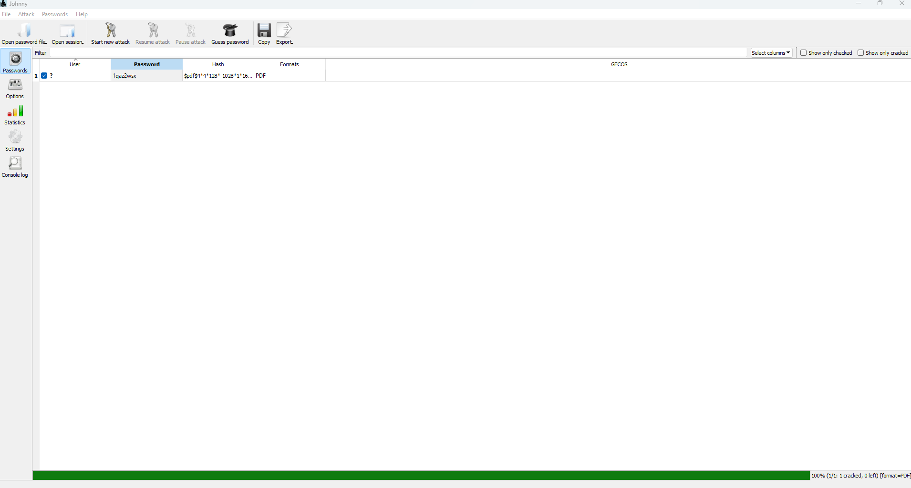

### Locked PDF 1
I cracked the password and it turned out to be `good-luck`.

Opening the PDF with that password revealed the flag: `nw{cybersecurity_flag_captured_2608}`

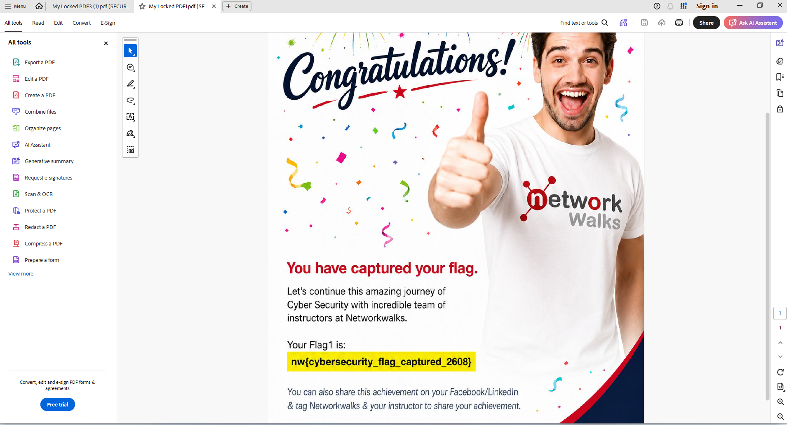

### Locked PDF 2
I cracked the password and it turned out to be `password1`.

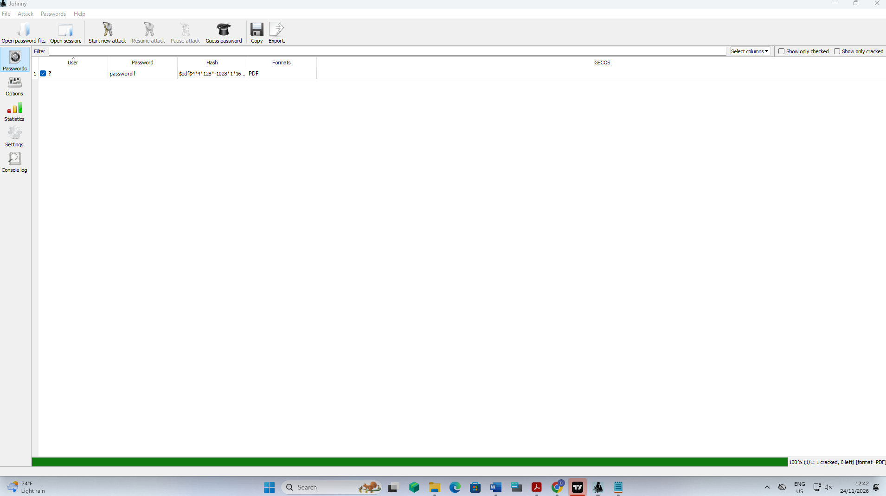

Opening the PDF with that password revealed the flag: `nw{networkwalks_persistence_jtr_270521}`

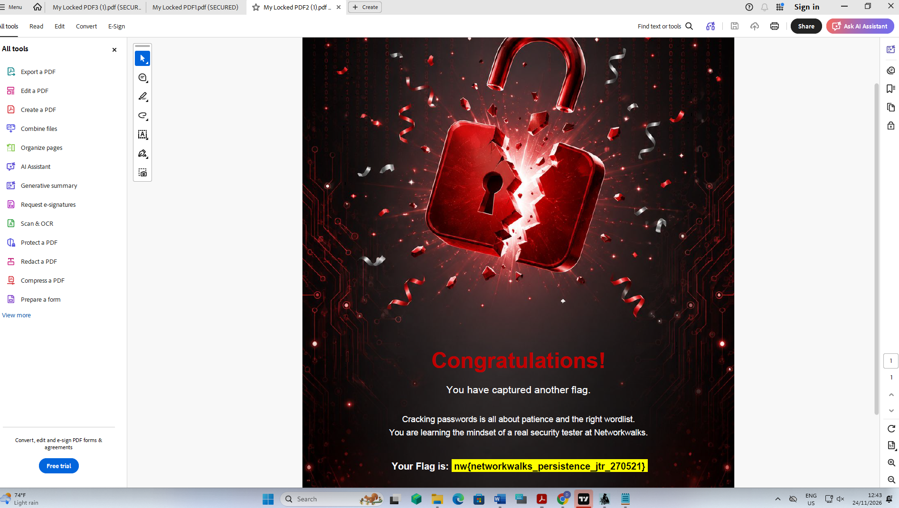

### Locked PDF 3
I cracked the password and it turned out to be `1qaz2wsx`.

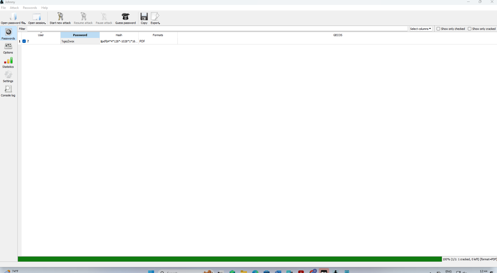

Opening the PDF with that password revealed the flag: `nw{networkwalks_flag_260821_1}`

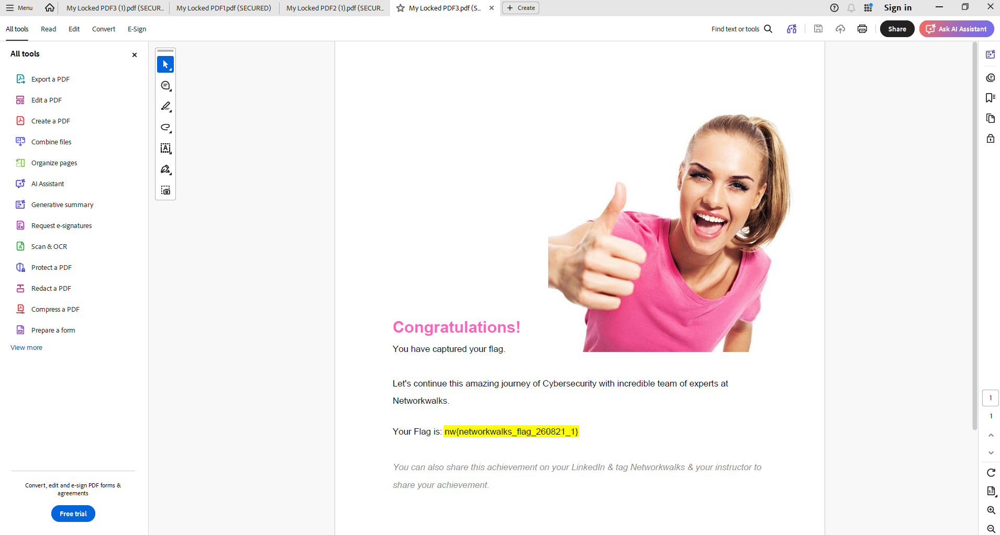

---

## W3-PM2: Password Cracking with NetworkWalks Tools

**Tool:** NetworkWalks Hash Calculator + Password Cracker (web-based dictionary attack lab)

**Method:**
1. Used the Hash Calculator to extract the `$pdf$` hash from each locked PDF.
2. Pasted the hash into the Password Cracker tool and ran the dictionary attack.
3. Opened each PDF with the recovered password to reveal its flag.

### Locked PDF 1
I cracked the password and it turned out to be `password1`.

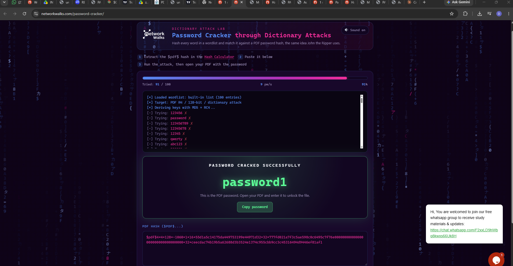

Opening the PDF with that password revealed the flag: `nw{networkwalks_flag1_jtr_270521_1}`

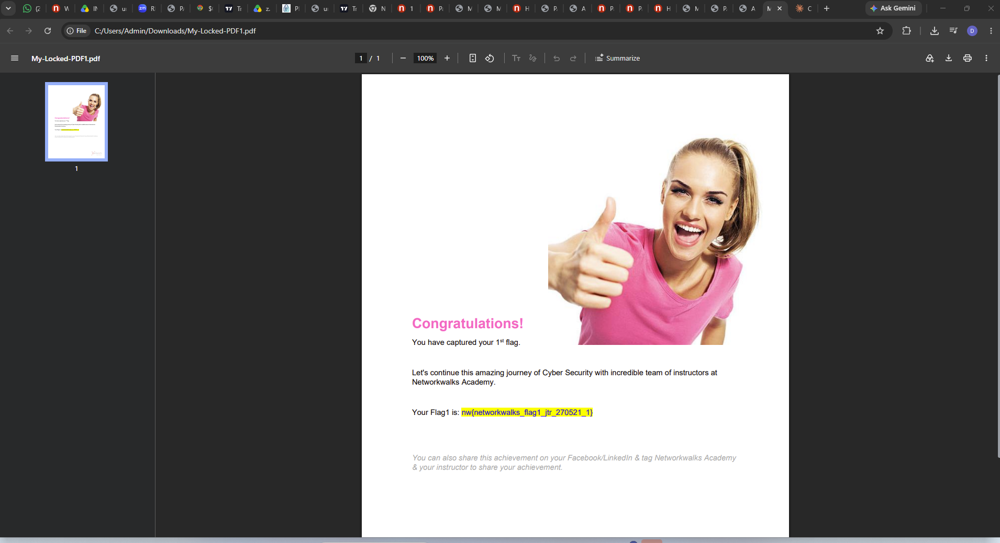

### Locked PDF 2
I cracked the password and it turned out to be `password1`.

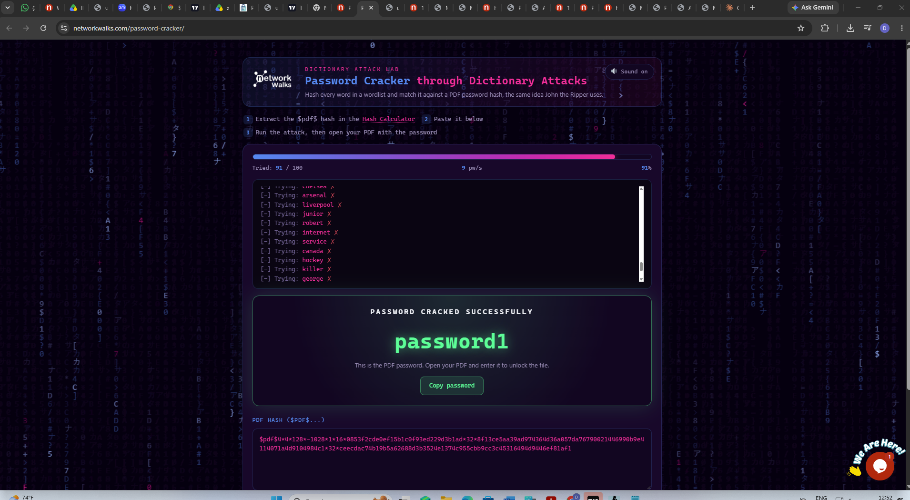

Opening the PDF with that password revealed the flag: `nw{networkwalks_persistence_jtr_270521}`

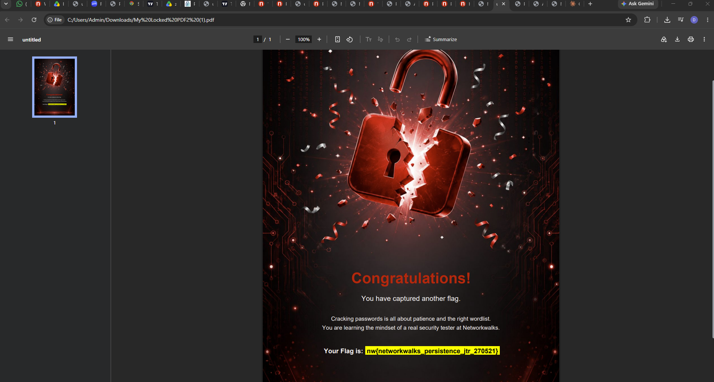

### Locked PDF 3
I cracked the password and it turned out to be `1qaz2wsx`.

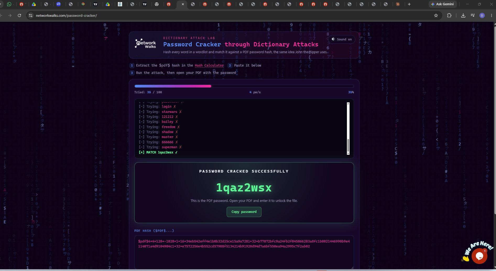

Opening the PDF with that password revealed the flag: `nw{networkwalks_flag_260821_1}`

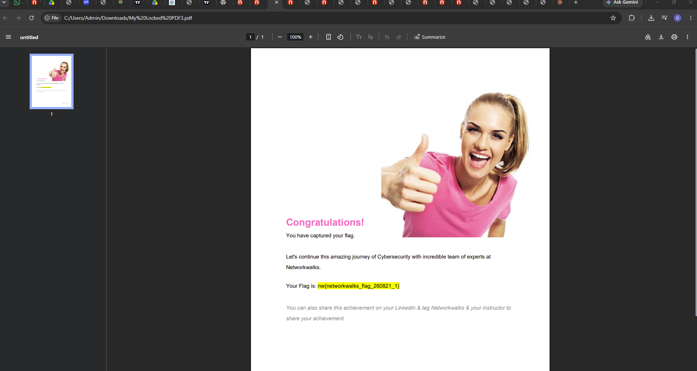

---

## Takeaway
Weak, dictionary-style passwords (`password1`, `1qaz2wsx`, `good-luck`) were cracked almost instantly by both tools, confirming that password strength — not the cracking tool used — is the real bottleneck for an attacker.
